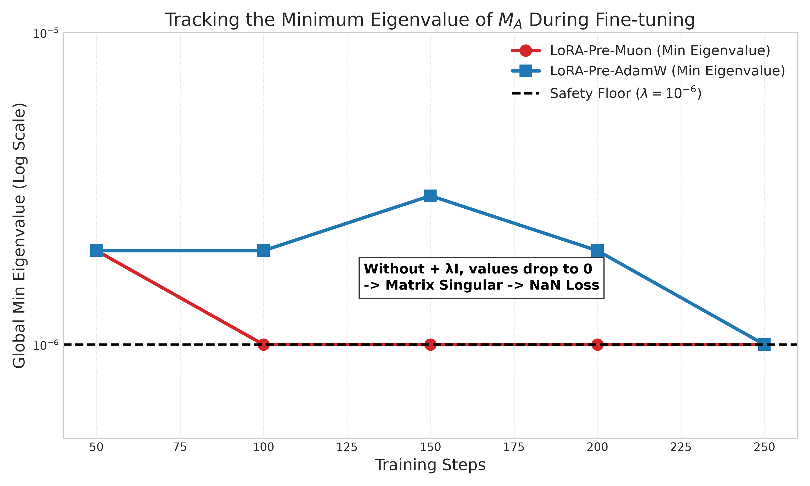

# Low-Rank Approximated Optimizers: Theory, Implementation, and Empirical Analysis

This repository contains a from-scratch reproduction and theoretical extension of the ICLR 2026 paper:
**"Taming Momentum: Rethinking Optimizer States Through Low-Rank Approximation"**

## Key Contributions
1. **From-Scratch Implementation**: Built 4 optimizers (`AdamW`, `LoRA-Pre-AdamW`, `Muon`, `LoRA-Pre-Muon`) entirely from scratch, bypassing the unreleased official code.
2. **Theoretical Extension**: Addressed the numerical instability of the original Newton-based derivation by introducing **L2 Regularization**. This mathematically guarantees strict matrix invertibility.
3. **Empirical Proof**: Tracked the minimum eigenvalues of the Hessian matrix during training to prove the necessity of our L2 regularization (preventing singular matrices and `NaN` loss).
4. **Comprehensive Benchmarks**: Conducted 11 experiments covering Pre-training (Loss/Memory) and Fine-tuning (ARC-Easy / TruthfulQA) across 4 optimizers on a consumer 6GB GPU (RTX 4050).

## Key Results (The Pareto Frontier)
LoRA-Pre-AdamW achieves "nearly lossless" compression during fine-tuning, retaining 100% of the model's reasoning capability while saving 15% memory. LoRA-Pre-Muon pushes memory usage below the 1GB barrier.


*Empirical proof of numerical stability via eigenvalue tracking:*


## Project Structure
### Core Optimizers
- `lora_pre_adamw_optimizer.py`: Custom LoRA-Pre-AdamW optimizer implementation.
- `muon_optimizers.py`: Custom Muon and LoRA-Pre-Muon optimizer implementations.

### Training Scripts
- `pretrain_smollm2.py` / `pretrain_adamw.py`: Baseline pre-training scripts.
- `pretrain_lora_pre_adamw.py`: LoRA-Pre pre-training.
- `pretrain_muon.py` / `pretrain_lora_pre_muon.py`: Muon family pre-training.
- `finetune_adamw.py` / `finetune_lora_pre_adamw.py`: Fine-tuning scripts (AdamW family).
- `finetune_muon.py` / `finetune_lora_pre_muon.py`: Fine-tuning scripts (Muon family).

### Evaluation & Plots
- `evaluate_TQA.py`: Evaluation script using `lm-evaluation-harness` for ARC-Easy and TruthfulQA.
- `plot_*.py`: Python scripts to generate all the figures in the `figures/` directory.

## Environment Setup
This project was developed in WSL2 (Ubuntu) with CUDA 12.4.

```bash
# Create a virtual environment
python3 -m venv smollm_env
source smollm_env/bin/activate

# Install dependencies
pip install -r requirements.txt
```

Tested Hardware: NVIDIA RTX 4050 Laptop GPU (6GB VRAM)
Base Model: HuggingFaceTB/SmolLM2-135M / SmolLM2-135M-Instruct

## How to Run
To reproduce the pre-training or fine-tuning results:

```bash
# Example: Run LoRA-Pre-AdamW Pre-training
python pretrain_lora_pre_adamw.py

# Example: Run LoRA-Pre-Muon Fine-tuning
python finetune_lora_pre_muon.py

# Example: Evaluate on TruthfulQA
python evaluate_TQA.py
```

## Citation
Zhengbo Wang et al. "Taming Momentum: Rethinking Optimizer States Through Low-Rank Approximation." ICLR 2026.