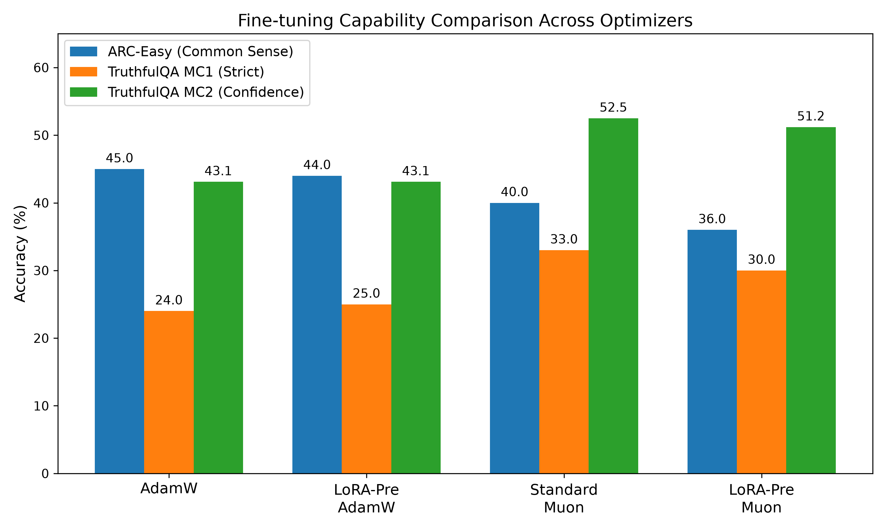
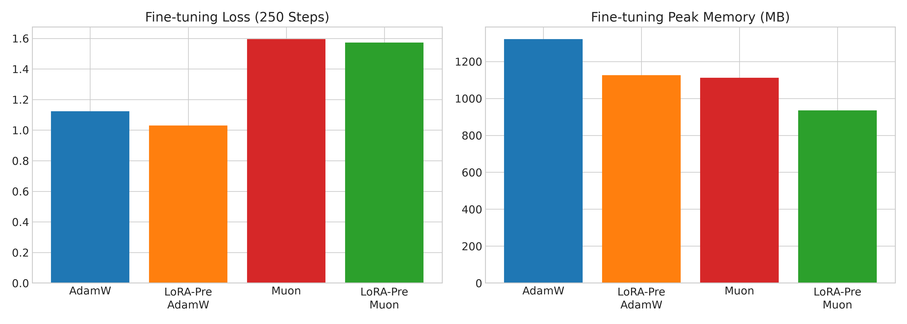
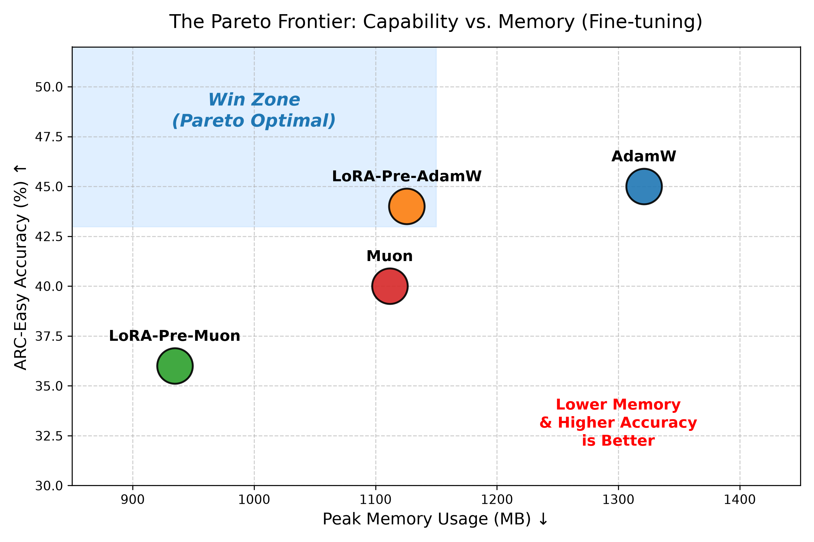
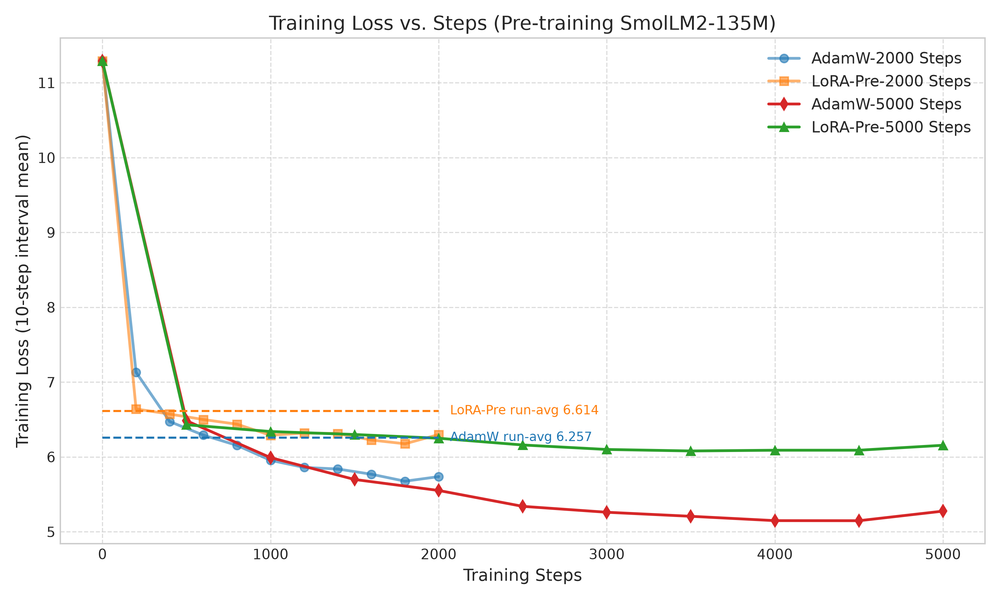
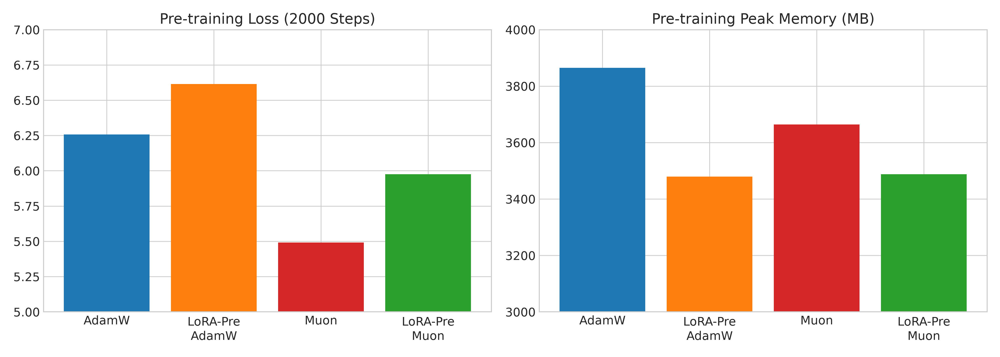
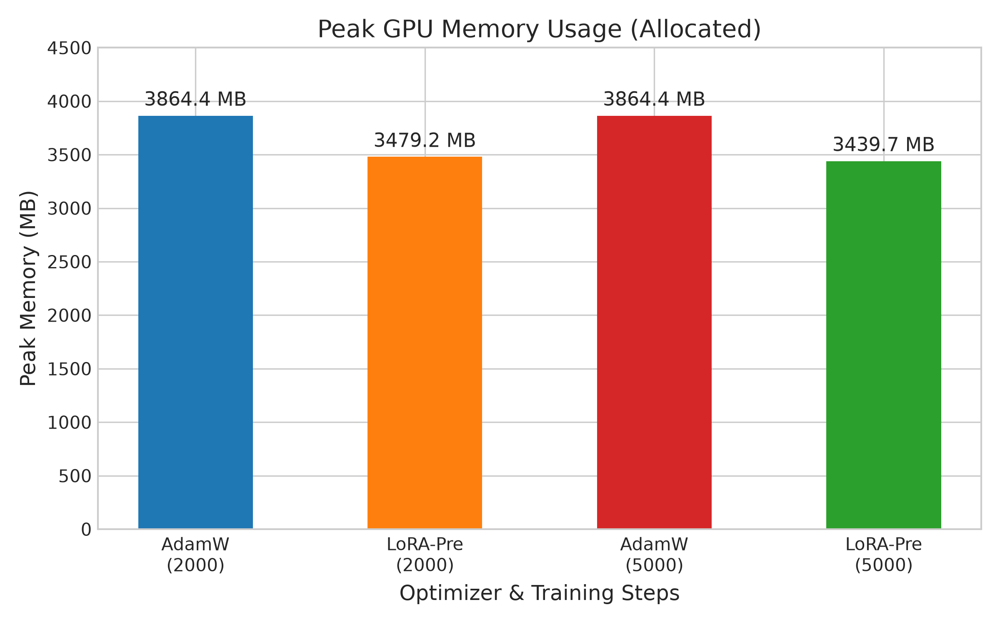
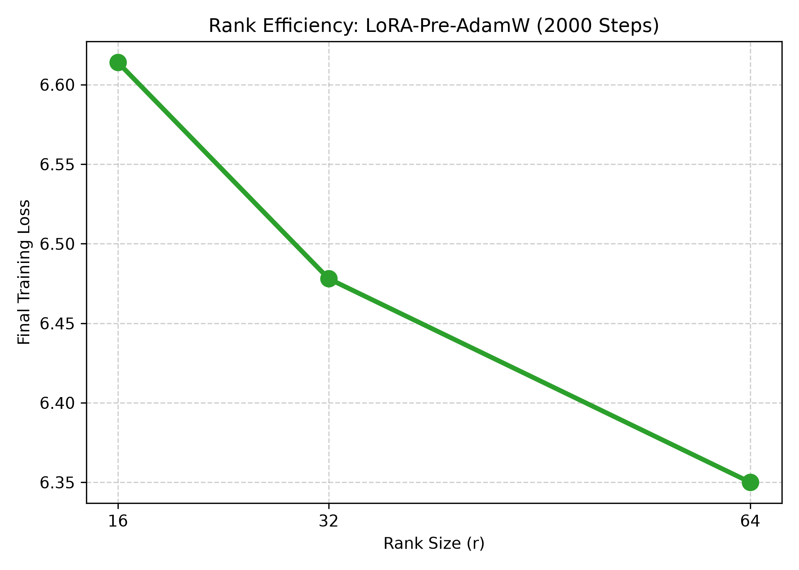

# Low-Rank Approximated Optimizers: Theory, Implementation, and Empirical Analysis

A from-scratch reproduction and theoretical extension of the ICLR 2026 paper
**"Taming Momentum: Rethinking Optimizer States Through Low-Rank Approximation"**.

Four optimizers — `AdamW`, `LoRA-Pre-AdamW`, `Muon`, `LoRA-Pre-Muon` — are implemented from scratch (no reliance on
the unreleased official code) and compared on pre-training and fine-tuning of `HuggingFaceTB/SmolLM2-135M` /
`SmolLM2-135M-Instruct`, on a single 6 GB consumer GPU.

## Key Contributions

1. **From-scratch implementation** of all four optimizers, including the low-rank momentum factorizations and the
   Newton-based preconditioner update.
2. **Theoretical extension**: the original Newton-based derivation can produce numerically singular matrices. We add an
   **L2 term (λI)** to the preconditioner, which guarantees strict invertibility by construction.
3. **Numerical evidence**: the global minimum eigenvalue of the optimizer state is logged every 50 steps, showing that
   with the λI term the preconditioner stays pinned at or above a 10⁻⁶ safety floor instead of collapsing through zero.
4. **Systematic benchmark**: 11 runs spanning pre-training (loss, peak memory, 2000 vs. 5000 steps) and fine-tuning
   (ARC-Easy, TruthfulQA MC1/MC2, peak memory, 250 steps).

## Results at a Glance

**Fine-tuning (250 steps).**

| Optimizer | ARC-Easy | TQA MC1 | TQA MC2 | Peak mem (MB) | Δ mem vs AdamW | Final loss |
|---|---|---|---|---|---|---|
| AdamW | **45.0** | 24.0 | 43.1 | 1321.1 | — | 1.124 |
| LoRA-Pre-AdamW | 44.0 | 25.0 | 43.1 | 1125.8 | **−14.8%** | **1.030** |
| Muon | 40.0 | **33.0** | **52.5** | 1111.7 | −15.8% | 1.595 |
| LoRA-Pre-Muon | 36.0 | 30.0 | 51.2 | **934.6** | **−29.3%** | 1.572 |

**Pre-training (2000 steps).** The loss column is the trainer's `train_loss` — the mean of the per-step batch losses
over the entire run.

| Optimizer | `train_loss` (run avg) | Peak mem (MB) | Δ mem vs AdamW |
|---|---|---|---|
| AdamW | 6.257 | 3864.4 | — |
| LoRA-Pre-AdamW | 6.614 | 3479.2 | −10.0% |
| Muon | **5.491** | 3664.3 | **+5.2%** |
| LoRA-Pre-Muon | 5.975 | 3487.7 | −9.7% |

What the numbers support:

- **Fine-tuning is where low-rank momentum compression pays off.** LoRA-Pre-AdamW costs 1.0 point of ARC-Easy
  (45.0 → 44.0), gains 1.0 point of TruthfulQA MC1, holds MC2 exactly (43.1 → 43.1), and saves **14.8%** peak memory.
  LoRA-Pre-Muon saves **29.3%** and lands at 934.6 MB, below the 1 GB barrier.
- **Muon trades common sense for calibration.** It gives up 5.0 points of ARC-Easy but gains 9.0 points of MC1 and
  9.4 points of MC2 — the largest calibration gain of any optimizer tested — while costing 5.2% *more* memory than
  AdamW during pre-training.
- **Pre-training is where low-rank hurts.** LoRA-Pre-AdamW saves 10.0% memory, but its run-average `train_loss` is
  0.357 nats worse than AdamW (6.614 vs. 6.257); the per-step gap at the end of a 2000-step run is 0.562 nats and
  widens to 0.880 at 5000 steps.

## Detailed Results

### 1. Fine-tuning accuracy — ARC-Easy vs. TruthfulQA



Per-benchmark breakdown that makes the two axes of the trade-off visible. The AdamW family dominates common-sense
reasoning (ARC-Easy 45.0 / 44.0); the Muon family dominates TruthfulQA (MC1 33.0 / 30.0, MC2 52.5 / 51.2). Low-rank
compression leaves MC2 bit-for-bit unchanged for the AdamW pair (43.1 → 43.1) and costs 1.3 points for the Muon pair
(52.5 → 51.2).



Left: fine-tuning loss after 250 steps. Right: peak fine-tuning memory. Both low-rank variants reach *lower*
fine-tuning loss than their full-rank counterparts (1.030 vs. 1.124 for the AdamW pair), which does not fully convert
into ARC-Easy accuracy — evidence that in-distribution loss and downstream accuracy are not the same objective.

### 2. Memory–accuracy Pareto frontier (fine-tuning)



All four configurations are non-dominated: each buys accuracy with memory and none is beaten on both axes at once.
The practically relevant point is LoRA-Pre-AdamW — 44.0 ARC-Easy for 1125.8 MB versus AdamW's 45.0 for 1321.1 MB,
i.e. **14.8% less memory for one accuracy point**. LoRA-Pre-Muon reaches 934.6 MB (29.3% below AdamW) at 36.0
ARC-Easy.

### 3. Pre-training — loss trajectory and memory



Loss over 5000 steps for the AdamW pair, at two step budgets. Each plotted point is itself a mean — the average over a
10-step logging interval (`logging_steps=10` with 4× gradient accumulation) — so the curve is smooth by construction.
The dashed horizontals mark each 2000-step run's `train_loss`: the mean of all 200 logged interval means, i.e. literally
the arithmetic mean of the plotted curve over that run. It sits above the tail because it also absorbs the high-loss
warmup phase (for LoRA-Pre-AdamW: first 20 intervals average 8.345, last 20 only 6.273).

LoRA-Pre is actually *ahead* for the first ~300 steps (6.641 vs. 7.132 at step 200) and falls behind afterwards, ending
the 2000-step run at 6.299 vs. 5.737 (**+0.562** over the final interval); by step 5000 the separation reaches
**+0.880** (6.156 vs. 5.276). Run-averaged, the two optimizers differ by **+0.357** (6.614 vs. 6.257).



Left: run-average pre-training loss after 2000 steps — Muon is strongest (5.491), then LoRA-Pre-Muon (5.975), AdamW
(6.257) and LoRA-Pre-AdamW (6.614). Right: corresponding peak memory — LoRA-Pre-AdamW saves 10.0% and LoRA-Pre-Muon
9.7%, while Muon costs 5.2% more than AdamW in exchange for its better loss.



Exact logged peak memory for the AdamW pair: 3864.4 → 3479.2 MB (−10.0%) at 2000 steps and 3864.4 → 3439.7 MB
(−11.0%) at 5000 steps. The saving is measured on allocated memory; the reserved peak of the LoRA-Pre 2000-step run
was 5304.0 MB, so this is "10–11% fewer allocated bytes", not a hard cap on device footprint.

### 4. Rank efficiency — the compression knob



Run-average pre-training loss of LoRA-Pre-AdamW at 2000 steps as a function of retained rank r ∈ {16, 32, 64}:
**6.614 / 6.478 / 6.350**, against an AdamW full-rank baseline of **6.257** on the same `train_loss` metric. Loss
decreases monotonically with rank, so rank is a genuine accuracy/compression knob: moving from r = 16 (the
configuration behind every headline number in this README) to r = 64 recovers 0.264 of the 0.357 gap to AdamW. Roughly
a quarter of the discrepancy is not recoverable by rank alone, which is the honest limit of this ablation.

Reproduce the headline runs with `rank=16` in `pretrain_lora_pre_adamw.py` / `finetune_lora_pre_adamw.py`; the `rank`
argument is the ablation knob, and `rank=64` corresponds to the rightmost point of this curve.

### 5. Numerical stability — the eigenvalue floor


Global minimum eigenvalue of the preconditioner M_A during fine-tuning, log scale, sampled every 50 steps. The dashed
line is the 10⁻⁶ safety floor contributed by the λI term.

| Step | 50 | 100 | 150 | 200 | 250 |
|---|---|---|---|---|---|
| LoRA-Pre-AdamW | 2×10⁻⁶ | 2×10⁻⁶ | 3×10⁻⁶ | 2×10⁻⁶ | 1×10⁻⁶ |
| LoRA-Pre-Muon | 2×10⁻⁶ | 1×10⁻⁶ | 1×10⁻⁶ | 1×10⁻⁶ | 1×10⁻⁶ |

LoRA-Pre-Muon drops onto the floor at step 100 and is held there for the rest of training (exactly 1×10⁻⁶, i.e. the
λ term), whereas LoRA-Pre-AdamW oscillates above it until step 250. The floor is therefore the *binding* constraint
for the Muon preconditioner: without λI these values would continue through zero, the matrix would become singular,
and the loss would diverge to `NaN`.

## Limitations

- **Every loss number here is a window average.** Each logged `loss` is the mean over the preceding 10 optimizer steps
  (4× gradient accumulation → 40 micro-batches); each table entry is the trainer's `train_loss`, the mean of all logged
  interval means over the run. No single-batch loss appears anywhere. A run-average **entangles convergence speed with
  final quality**: AdamW drops faster in the second half, so its mean is pulled down more than its trajectory shape
  alone would suggest, and the run-average gap (+0.357) is *smaller* than the gap at the end of training (+0.562) — the
  average is dominated by the mid-run region, where the two curves are closest (~0.30). A last-25% mean (6.268 for
  LoRA-Pre-AdamW) or a held-out evaluation would be the sharper instrument and is not reported.
- **Single seed per configuration.** No error bars, so a ±1 point difference on ARC-Easy (45.0 vs. 44.0) is within
  plausible seed variance rather than a measured effect. The 5–9 point gaps between the AdamW and Muon families are
  large enough to be meaningful; the 1 point gap is not.
- **Scale.** SmolLM2-135M, ≤ 5000 steps, one 6 GB GPU. The optimizer state is small relative to activations at this
  width, so relative memory savings will differ at larger widths and longer runs.
- **Stability evidence is partly constructive.** The eigenvalue plot contains only runs *with* the λI term, all of
  which sit at or above the floor. The `NaN` failure mode without λI is supported by the values being pinned exactly
  at λ and by the annotation, but the diverging control run is not plotted.

## Project Structure

### Core optimizers
- `lora_pre_adamw_optimizer.py`: LoRA-Pre-AdamW optimizer.
- `muon_optimizers.py`: Muon and LoRA-Pre-Muon optimizers.

### Training scripts
- `pretrain_lora_pre_adamw.py`: LoRA-Pre-AdamW pre-training, 2000 steps (r=16 → `train_loss` 6.614, peak 3479.2 MB).
- `pretrain_adamw.py`: full-rank AdamW baseline, used at both step budgets. Reproducing a run means setting:

  | run | `max_steps` | `warmup_steps` | `save_steps` | `output_dir` |
  |---|---|---|---|---|
  | 2000 steps (`train_loss` 6.257, peak 3864.4 MB) | 2000 | 200 | 1000 | `./smollm2-pretrained-adamw-2000steps` |
  | 5000 steps (endpoint 5.276) | 5000 | 500 | 2500 | `./smollm2-pretrained-adamw-5000steps` |

- `pretrain_muon.py` / `pretrain_lora_pre_muon.py`: Muon-family pre-training.
- `finetune_adamw.py`: AdamW baseline fine-tuning (evolved from the initial `train_smollm2.py`).
- `finetune_lora_pre_adamw.py`: LoRA-Pre-AdamW fine-tuning.
- `finetune_muon.py` / `finetune_lora_pre_muon.py`: Muon-family fine-tuning.

Each pre-training script writes to its own `./smollm2-*` directory so that runs cannot overwrite each other's
checkpoints, and every fine-tuning script starts from the released `SmolLM2-135M` weights rather than from a local
pre-training output — the fine-tuning and pre-training experiments are independent tracks.

### Evaluation & plots
- `evaluate_TQA.py`: ARC-Easy / TruthfulQA evaluation via `lm-evaluation-harness`.
- One plotting script per figure, all writing into `figures/`:

  | Script | Figure |
  |---|---|
  | `plot_results.py` | `loss_comparison.png`, `memory_comparison.png` |
  | `plot_all_results.py` | `pretrain_family.png`, `finetune_family.png` |
  | `plot_pareto_frontier.py` | `pareto_frontier.png` |
  | `plot_rank_efficiency.py` | `rank_efficiency.png` |
  | `plot_eigen.py` | `eigenvalue_stability.png` |
  | `plot_ft_accuracy.py` | `finetune_accuracy_combined.png` |

## Environment

Developed in WSL2 (Ubuntu) with CUDA 12.4.

```bash
python3 -m venv smollm_env
source smollm_env/bin/activate
pip install -r requirements.txt
```

Tested hardware: NVIDIA RTX 4050 Laptop GPU (6 GB VRAM)
Base models: `HuggingFaceTB/SmolLM2-135M`, `SmolLM2-135M-Instruct`

## How to Run

```bash
# Pre-training (each script writes to its own ./smollm2-* directory)
python pretrain_lora_pre_adamw.py 2000 16   # LoRA-Pre-AdamW; args: [steps] [rank]
python pretrain_adamw.py 2000               # AdamW baseline; pass 5000 for the longer budget

# Fine-tuning
python finetune_lora_pre_muon.py

# Evaluation (ARC-Easy / TruthfulQA)
python evaluate_TQA.py

# Figures (all scripts write into ./figures/)
python plot_results.py
python plot_all_results.py
python plot_pareto_frontier.py
python plot_rank_efficiency.py
python plot_eigen.py
python plot_ft_accuracy.py
```

## Citation

Zhengbo Wang et al. "Taming Momentum: Rethinking Optimizer States Through Low-Rank Approximation." ICLR 2026.